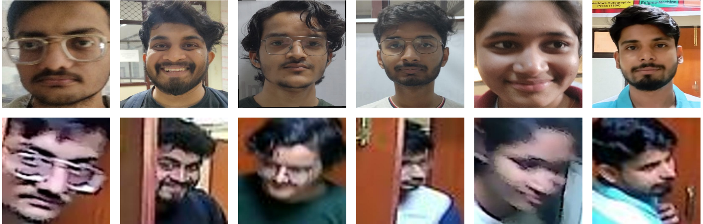
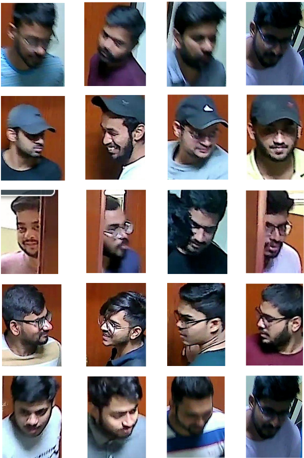

# CVBL-CCTV-Face Dataset

**CVBL-CCTV-Face Dataset for Real-World Face Enhancement and Recognition in Surveillance**

**Manish Das, Ajay Kumar Yadav, Shiv Ram Dubey, and Satish Kumar Singh**  
Computer Vision and Biometrics Lab (CVBL), Indian Institute of Information Technology Allahabad, India.

## Introduction

The **CVBL-CCTV-Face Dataset** is a real-world facial image dataset developed for research on face enhancement and recognition under challenging CCTV surveillance conditions. Unlike datasets that rely primarily on high-quality images or synthetic degradations, CVBL-CCTV-Face contains authentic low-quality (LQ) face images captured using an **8MP IP Dome CCTV camera (EW-IP8050D)** in unconstrained indoor environments. High-quality (HQ) reference images were captured separately under controlled conditions. The LQ and HQ images are therefore **unpaired at the image level and not spatially aligned**, while corresponding to the same identities.

The dataset contains **18,376 facial images from 223 unique identities**, including **15,662 LQ CCTV images** and **2,714 HQ reference images**. It is available in two versions:

- **Version A:** 102 identities, with 8,090 LQ images and 102 HQ images (one HQ reference per identity).
- **Version B:** 130 identities, with 7,572 LQ images and 2,612 HQ images (15–25 HQ references per identity).

The versions share **nine identities**, giving **223 unique identities** across the complete collection.

The dataset reflects authentic surveillance challenges such as motion blur, defocus, low resolution, illumination changes, sensor noise, occlusions, side-facing views, and downward head poses. It is intended to support research on robust face enhancement, face super-resolution, and facial recognition under real-world acquisition conditions.

## Sample Images

**Figure 1:** Representative samples from the CVBL-CCTV-Face Dataset. The top row shows high-quality (HQ) reference images acquired under controlled conditions, while the bottom row shows corresponding low-quality (LQ) CCTV face images.

## Challenges in the Dataset

The CVBL-CCTV-Face Dataset includes several challenging face appearances observed in real-world surveillance:

- **Blurred Faces:** Motion blur and defocus reduce facial detail.
- **Occlusions by Accessories:** Caps and other accessories hide important facial regions.
- **Partially Visible Faces:** Doors, walls, or other objects obstruct parts of the face.
- **Pose Variations:** Side-facing and non-frontal views alter facial appearance.
- **Downward Head Poses:** Downward-facing subjects obscure features such as the eyes and mouth.

**Figure 2:** Examples of challenges in the CVBL-CCTV-Face Dataset. Rows from top to bottom illustrate blurred faces, faces occluded by caps, partially visible faces, side-facing poses, and downward head poses.

## Download CVBL-CCTV-Face Dataset

The CVBL-CCTV-Face Dataset is made available for **approved research use** through a controlled-access request process.

To request access, please download and complete the **[CVBL-CCTV-Face Dataset License Agreement](CVBL-CCTV-Face%20Dataset%20License%20Agreement.pdf)** and email the signed form to ** [srdubey@iiita.ac.in](mailto:srdubey@iiita.ac.in) and [pmm2023001@iiita.ac.in](mailto:pmm2023001@iiita.ac.in)**.
 Note that the license form must be filled out by a faculty member who is the Lab Incharge/Head of Department/Head of Institute. A dataset download link will be shared after the request has been reviewed and approved. **Please do not redistribute, publicly post, or otherwise share the facial images without written authorization.**

## Citation

Any research work or public publication based directly or indirectly on the CVBL-CCTV-Face Dataset should cite:

M. Das, A. K. Yadav, S. R. Dubey, and S. K. Singh, "CVBL-CCTV-Face Dataset for Real-World Face Enhancement and Recognition in Surveillance", 5th IEEE International Conference on Computer Vision and Machine Intelligence (CVMI), Pune, India, Oct.–Nov. 2026.
